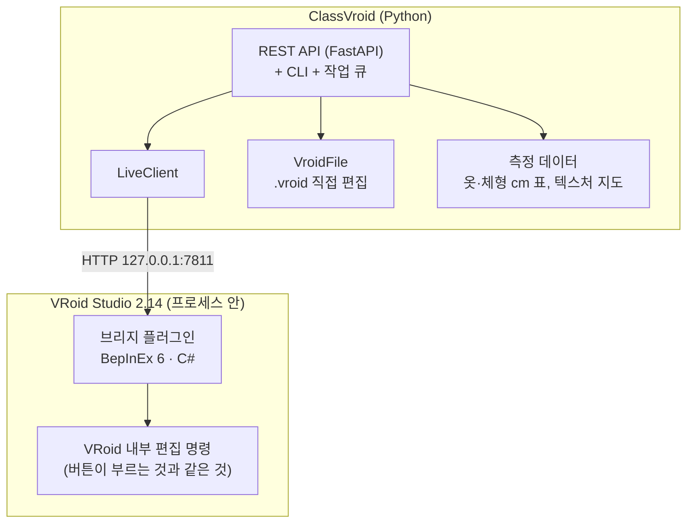

# 3. 구조와 원리

[[ClassVroid]]로 돌아가기 · 이전: [[2. 기능 정리]]

## 세 덩어리

### 1) 브리지 — VRoid 안의 플러그인
- VRoid는 Unity(IL2CPP)로 만들어져 있습니다. **BepInEx 6** 플러그인으로 VRoid 프로세스 안에 들어가 **Il2CppInterop**으로 내부 클래스를 부릅니다.
- 화면 버튼이 쓰는 **편집 명령(`…Command`)을 그대로 만들어 실행**합니다. 그래서 VRoid에서 되돌리기가 되고, 저장 파일도 사람이 만든 것과 같습니다.
  - 예: 헤어 펜 = `StrokeHairCommand`, 룩 = `ModifyGlobalParametersCommand`
- 모든 명령은 **메인 스레드 큐**로 넘기고 끝날 때까지 기다립니다. 응답이 없으면 시간 초과를 돌려줍니다(API는 503).
- 기반: [mcjo79/vroid-mcp](https://github.com/mcjo79/vroid-mcp) 0.15.0 (MIT)의 경로 52개 위에 **직접 52개를 추가**했습니다.
  - 추가한 것: 헤어 가닥·그룹·가이드·본, 텍스처 레이어, 옷 템플릿, 룩, 액세서리, 화면 메시 읽기 등

### 2) 파일 편집 — `.vroid`를 직접 읽고 쓰기
- `.vroid`는 ZIP 안의 protobuf입니다. 공개된 스키마가 없어서 **필드 번호로** 읽고 고칩니다(모르는 필드는 그대로 둠).
- VRoid가 화면에 보여 주지 않는 재질 칸(노멀맵·매트캡 등)도 열 수 있습니다.
- 원본 파일은 **덮어쓰지 않습니다.** 항상 새 파일로 저장합니다.

### 3) 측정 데이터 — "감" 대신 숫자
| 데이터 | 어떻게 만들었나 |
| --- | --- |
| 옷 슬라이더 표 (538개) | 내 PC VRoid의 옷 템플릿 메시로 슬라이더마다 밑단·소매·허리·밑창이 몇 cm 움직이는지 계산 |
| 체형 슬라이더 표 (23개) | VRoid를 실제로 돌려 키마다 0.1·0.5·1·2를 넣고 **화면의 피부 메시**를 꺼내 치수 30가지를 잼 (여·남 각 2분) |
| 텍스처 지도 | 메시의 UV 섬을 조각으로 나누고 **뼈 가중치로 이름**(소매·치마·위팔·손등 …)을 붙임 → VRoid에 시험 텍스처를 입혀 확인 |
| 옷 칠하기 기준 | 공식 샘플 20개의 주름·명암·노이즈를 재서 숫자로 정의 |

## 데이터 원칙
- **pixiv(VRoid)의 데이터는 넣지 않습니다.** 메시·샘플 텍스처·VRoid 화면 문구는 저장소에 없습니다.
  - 메시가 필요한 기능은 사용자가 자기 PC의 VRoid에서 직접 꺼냅니다(`classvroid templates extract`).
  - 저장소에는 **코드와 숫자 측정값**만 들어 있습니다.
- 개인 경로·이메일도 넣지 않습니다.
  - 0.15에서 동봉 플러그인 DLL에 빌드 PC 경로가 남아 있던 것을 찾아, 디버그 정보 없이 다시 빌드했습니다.
  - 다시 들어가면 테스트가 실패합니다.
- 남의 코드(mcjo79/vroid-mcp, MIT)와 내가 만든 부분은 `bridge/` 폴더와 `NOTICE.md`로 구분합니다.

## 테스트 — VRoid 없이도 검증
- **198개, 커버리지 94%.** VRoid도 pixiv 데이터도 없이 돌아갑니다.
- `MockLive`: 메모리 안의 가짜 VRoid. 부위·슬라이더·텍스처·되돌리기를 흉내 냅니다.
- `tests/fake_bridge.py`: 실제 HTTP로 응답하는 가짜 브리지(계약 테스트). 브리지 응답 형식이 바뀌면 깨집니다.
- 합성 데이터: 옷 메시, 뼈 가중치가 붙은 몸(관 모양 팔다리) 같은 것을 테스트 안에서 만듭니다.

## "완료"의 기준
- **VRoid 앱에서 직접 확인한 것만 완료라고 적습니다.**
  - 기능마다 VRoid에서 실제로 돌리고, 저장 → 다시 열기 → 화면·값이 그대로인지 봅니다.
  - 숫자로 비교할 수 있는 것은 VRoid 화면의 메시를 꺼내 비교합니다.
- 기능마다 확인 결과와 한계를 `docs/RESEARCH.md`·`CHANGELOG.md`에 남깁니다.

## 한계
- 비공식이고 **VRoid Studio 2.14.0 기준**입니다. 플러그인이 VRoid 내부를 쓰므로 업데이트 때 깨질 수 있습니다.
- 헤어 흔들림은 구조(본)만 확인했고, 움직임은 눈으로 보지 않았습니다.
- Steam판 VRoid 경로 찾기는 코드만 있고 실제 Steam 설치에서는 확인하지 않았습니다.

다음: [[4. 버전 기록]]
