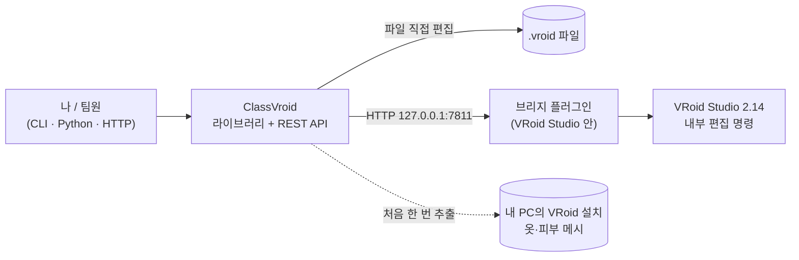

# ClassVroid — VRoid Studio를 코드로 다루는 API

> [!info] 현재 상태 (2026-11-20)
> - 버전 **0.15.0**
> - **GitHub에는 올리지 않았습니다.** 지금은 **개인 파일 전달**(ZIP)로만 공유합니다.
> - **팀 프로젝트가 끝난 뒤 GitHub에 공개할 예정**입니다.

## 한 줄 소개
VRoid Studio에는 프로그램에서 부를 수 있는 **공식 API가 없습니다.** 그래서 VRoid 안에 플러그인을 넣어 내부 기능을 열고, 그 위에 **Python 라이브러리 · 명령어(CLI) · HTTP API**를 만들었습니다.
사람이 화면을 눌러야 하던 일(얼굴·헤어·옷·체형 바꾸기, 텍스처 넣기, 저장, VRM 내보내기)을 **코드 한 줄이나 JSON 한 장**으로 할 수 있습니다.

## 무엇을 할 수 있나

| 영역           | 할 수 있는 것                                                                                         | VRoid 실행 필요 |
| ------------ | ------------------------------------------------------------------------------------------------ | ----------- |
| 캐릭터 한 번에 만들기 | JSON 한 장으로 새 모델 → 프리셋 → 슬라이더 → 색 → 피부 → 헤어 본 → 저장 → VRM                                          | O           |
| 얼굴           | 눈·눈썹·속눈썹·아이라인·코·입·입술·볼터치 등 17부위의 프리셋·색·텍스처, **그림을 코드로 생성**(동공 모양, 오드아이, 하이라이트, 입술 광택, 볼터치 무늬…)   | 일부          |
| 헤어           | 프리셋을 칸별로 조합, 색·그러데이션 그림, **펜으로 새 가닥 그리기**, 새 가닥 그룹, 가이드 모양(긴 생머리), 재질(인너 컬러), **흔들림 본 자동 점검·보충** | O           |
| 옷 모양         | 옷 템플릿 33종의 슬라이더 538개를 cm로 재 놓은 표, **"기장 +10 cm"처럼 cm로 요청**                                       | O           |
| 체형           | 체형 슬라이더 23개를 cm로 재 놓은 표, **"키 165 cm, 다리 83 cm"처럼 cm로 요청**                                       | O           |
| 텍스처 지도       | 옷 33종·몸 피부·얼굴 피부 텍스처의 어느 부분이 몸 어디에 붙는지(조각 이름·방향·크기·이음선)                                          | X           |
| .vroid 파일    | VRoid 없이 파일을 직접 읽고 고치기: 레이어, **화면에 없는 재질 칸**(노멀맵·매트캡·외곽선), 옷 자동 칠하기                              | X           |
| 설치           | VRoid 쪽 준비(BepInEx + 플러그인)를 명령 하나로                                                               | —           |
|              |                                                                                                  |             |

## 숫자로 보기
| 항목 | 값 |
| --- | --- |
| HTTP API | 73개 작업 (FastAPI, 자동 문서 `/docs`) |
| CLI 명령 | 20개 묶음 (`classvroid live`, `face`, `hair`, `outfit`, `body`, `skin` …) |
| VRoid 안 플러그인 경로 | 104개 (원본 52 + 직접 추가 52) |
| 테스트 | 198개, 커버리지 94% (VRoid 없이도 돌아감) |
| 직접 잰 데이터 | 옷 슬라이더 538개 · 체형 슬라이더 23개(키 43개 × 여·남) · 텍스처 지도 옷 33종 + 피부 2장 |
| 문서 | PDF 59쪽 + HTML 레퍼런스 (ZIP 안 `docs/`) |

## 어떻게 생겼나

- **브리지**: VRoid 안에서 도는 플러그인입니다. VRoid가 버튼을 누를 때 쓰는 내부 명령을 그대로 부르므로, VRoid에서 되돌리기(Ctrl+Z)도 됩니다.
- **라이브러리·API**: 브리지와 `.vroid` 파일을 감싸서 쓰기 쉽게 만든 층입니다. 사람이 이해하는 단위(부위 이름, cm, 색)로 받습니다.
- **측정 데이터**: 옷·체형 슬라이더가 몇 cm 움직이는지는 VRoid에서 직접 재서 표로 넣었습니다. VRoid의 메시 자체는 넣지 않습니다.

자세한 설명: [[3. 구조와 원리]]

## 문서 목록
1. [[1. 설치와 시작]] — 받은 ZIP으로 설치하고 첫 캐릭터 만들기
2. [[2. 기능 정리]] — 영역별 명령어·API 예시
3. [[3. 구조와 원리]] — 어떻게 동작하나, 데이터 원칙, 테스트
4. [[4. 버전 기록]] — 0.1.0부터 0.15.0까지

## 공개(GitHub) 전에 할 일
- [ ] 팀 프로젝트 마무리 후 공개 범위 합의
- [ ] VRoid Studio 이용약관 다시 확인 (플러그인 DLL 배포 포함)
- [ ] 원본 플러그인([mcjo79/vroid-mcp](https://github.com/mcjo79/vroid-mcp), MIT) 표기 유지 — 이미 `NOTICE.md`·`bridge/LICENSE-vroid-mcp`에 있음
- [ ] pixiv(VRoid) 데이터가 들어가지 않았는지 마지막 점검 — 지금은 메시·샘플 없이 숫자 측정값만 들어 있음

## 다음 계획
- **헤어 새로 만들기**: 프리셋을 가져오지 않고 처음부터 — 앞머리 가이드 10개 이상, 뒷머리 가이드 20개 이상, 가이드마다 가닥 10개 이상
- 팀 프로젝트 후 GitHub 공개
