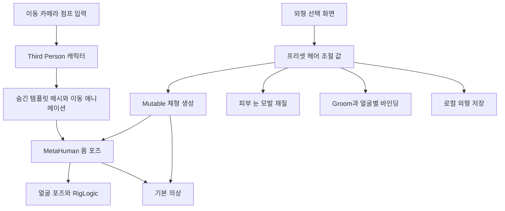

# Meshy NPC 제작에서 MetaHuman 플레이어 커스터마이징까지

별도 시험 프로젝트 **TheQueen**을 만들고, 이미지 기반 NPC 제작과 플레이어 외형 변경을 시험했다. 기존 IsekaiClass에 통합한 작업은 아니다. 목표는 **기본 플레이어를 조작할 수 있고, 붉은 머리 한복 캐릭터 NPC1이 테스트 맵에서 대기와 걷기를 하는 상태**였다.

현재 구성은 **기존 고정 외형 NPC1 + MetaHuman 플레이어 + Mutable 체형 변경**이다. 남녀 기본 인체 2종, 추가 헤어 8종과 피부·눈·모발·체형 38개 조절 항목을 연결하고 저장·복원을 확인했다. 자유로운 얼굴 조형과 다양한 의상의 모든 조합까지 완성한 단계는 아니다.

## 1. 프로젝트와 NPC 역할을 먼저 분리했다

설치된 엔진은 **Unreal Engine 5.8.4**였고, 공식 **Third Person C++ 템플릿**으로 프로젝트를 시작했다. Visual Studio 2022 Community, MSVC 14.44.35226, Windows SDK 10.0.22621.0으로 빌드했다. 테스트 맵은 `Lvl_NPC1Test`다.

`character_front.png`의 붉은 머리 한복 캐릭터는 **NPC1 전용 참고 이미지**로 지정했다. NPC는 고정 외형과 대기·걷기 애니메이션을 사용하고, 플레이어의 성별·외형 선택 데이터와 분리했다.

| 역할 | 현재 사용 방식 |
| --- | --- |
| NPC1 | 기존 스킨 메시와 전용 대기·걷기 클립을 유지하는 고정 캐릭터 |
| 플레이어 | Third Person 조작을 유지하면서 MetaHuman 외형을 표시 |
| 외형 화면 | C++와 UMG로 만든 선택·슬라이더·회전·확대·저장 UI |
| 저장 데이터 | 프리셋 ID, 헤어 ID, 조절 값과 스키마 버전 |

설치된 엔진의 Python 원격 실행 기능으로 에디터에 연결해 에셋 구성과 PIE 검증을 수행했다. 캐릭터 생성용 외부 API 키는 로컬에서 입력받고 Windows 사용자 전용 암호화로 보관했다. 키를 게임 코드·Content·TIL에 포함하지 않았다.

## 2. Meshy 모델은 모듈형 플레이어와 요구사항이 달랐다

NPC1 이미지를 Meshy에서 전신 모델로 생성하고 자동 리깅을 적용했다. 요청한 주요 설정은 Meshy 7.1, A 포즈, PBR, 4K 텍스처, 목표 약 6만 삼각형이었다. 원본 모델은 약 **61,192개 삼각형**, 단일 메시·재질/UV 아틀라스를 사용하는 구조였다.

Blender에서 생성 원본과 리깅 원본을 따로 보관하고, 수정본에는 고정 root를 추가했다. 최대 4개 본 영향으로 웨이트를 정리하고 치마 밑단을 보정했다. 대기 클립을 만들고, 리깅에 포함된 걷기 클립을 수정해 테스트 맵에 연결했다.

> [!example]- 초기 NPC1 대기와 걷기 검증
>
> **MetaHuman 전환 전의 초기 실행 화면**이다. 당시 Quinn 임시 플레이어와 녹색 시험 구조물이 보이며, 피부색·눈 표현을 포함한 최종 외형 승인 사진으로 사용하지 않는다.
>
> 대기
>
> ![[20261108-thequeen-npc1-initial-idle.png]]
>
> 걷기
>
> ![[20261108-thequeen-npc1-initial-walk.png]]

플레이어는 머리·눈·모발·몸·옷 교체와 얼굴·체형 변경이 필요했다. 생성 모델을 가져오는 것만으로는 다음 데이터가 자동으로 준비되지 않았다.

- 옷 아래까지 이어지는 기본 인체와 안정적인 관절 토폴로지
- 교체 가능한 독립 파츠와 목 경계 규격
- 남녀가 함께 사용할 스켈레톤과 파츠별 스킨 웨이트
- 얼굴·체형 모프, 눈꺼풀과 독립 안구의 대응 변형
- 체형이 달라질 때 옷을 맞추는 보정 데이터

이후 남녀 인체·머리와 긴 머리카락을 추가 생성하고, Blender에서 파츠 분리·공통 리그·모프를 시험했다. 다만 **참고 이미지와의 일치도와 헤어 품질이 원하는 수준으로 검수되지 않아 이 플레이어 제작 방향을 중단**했다. API 작업 성공이나 모프의 존재와, 원하는 외형의 완성도는 서로 다른 검증 항목이었다.

생성 기록을 합산하면 다음과 같다. 최종 MetaHuman 전환에는 추가 Meshy 유료 생성을 사용하지 않았다.

| Meshy 작업 | 모델 생성 | 리깅 | 합계 크레딧 |
| --- | ---: | ---: | ---: |
| NPC1 전신 | 30 | 5 | 35 |
| 여성 플레이어 몸·머리 실험 | 50 | 5 | 55 |
| 남성 플레이어 몸·머리 실험 | 50 | 5 | 55 |
| 긴 머리카락 실험 | 35 | 0 | 35 |
| 합계 | 165 | 15 | **180** |

총 **모델 생성 6건·리깅 3건**이다. 입력 이미지, 작업 ID, 응답, 다운로드와 수정본을 구분해 보관했다. 최초 NPC 제작 기록의 35크레딧은 당시 구간의 합계이고, 전체 실험 비용은 180크레딧이다.

## 3. 플레이어를 공식 MetaHuman 프리셋으로 전환했다

NPC1은 유지하고, 플레이어는 설치된 **Epic MetaHuman Creator Core Data**의 **Ada·Bo**를 프로젝트에 복제해 사용했다. 얼굴 리그와 텍스처를 준비하고 **UE Optimized High** 품질로 조립했다. 이름만으로 분류했던 초기 프리셋은 실제 화면을 확인한 뒤 최종 선택지에서 제외했다.

현재 기본 얼굴과 인체는 새로 조형한 독자 에셋이 아니라 **공식 프리셋을 출발점으로 한 결과**다. 현재 선택 가능한 두 얼굴은 첫 구현의 범위이며, MetaHuman Creator 자체의 최대 편집 범위를 뜻하지 않는다.



이동·카메라·점프는 기존 Third Person 캐릭터가 담당한다. 템플릿 메시를 숨긴 채 애니메이션을 계속 평가하고, 화면에 보이는 MetaHuman 몸으로 포즈를 전달한다. 얼굴은 몸의 포즈와 RigLogic을 함께 사용하고 옷은 몸의 포즈를 따른다.

남녀 원본 몸 메시가 같은 `metahuman_base_skel`을 참조하는 것도 확인했다. 스켈레톤의 공통 에셋 경로에 `Female/Medium/NormalWeight`가 포함되어 있었지만, 경로명만으로 각 캐릭터의 외형을 판단하지 않았다.

## 4. 외형 선택값과 적용 방법을 데이터로 분리했다

`DA_MetaHumanPlayer`에 기본 프리셋, 헤어 에셋, 프리셋별 바인딩과 조절 항목을 모았다. 각 항목은 ID·표시 이름·분류·최솟값·최댓값·기본값·적용 방법을 가진다.

| 분류 | 개수 | 실제 적용 |
| --- | ---: | --- |
| 피부 | 6 | 색조·명도·채도·거칠기·광택·표면 디테일 재질 파라미터 |
| 눈 | 10 | 홍채 기본색·보조색·혼합·밝기·동공·홍채 크기·테두리·거칠기 |
| 모발 | 13 | 길이, 염색 색상·채도·밝기, 색소·적갈색·거칠기·백발·하이라이트·그라데이션 |
| 체형 | 9 | 전체 키와 체격·근육·어깨·흉곽·허리·골반·팔·다리 |
| 합계 | **38** | 재질·Groom·Mutable·전체 크기 조절을 각각 연결 |

피부·눈·모발은 캐릭터별 **동적 재질 인스턴스**로 조절한다. 공용 원본 재질을 직접 수정하지 않는다. 체형 8개는 몸과 기본 옷에 같은 좌표 기준의 모프를 만들고 Mutable에서 함께 적용한다. 현재 키 조절은 **캐릭터 전체 크기 변경**이며, 팔다리 길이를 독립적으로 바꾸는 기능과 구분한다.

저장에는 배열 번호 대신 안정적인 ID를 사용했다.

```text
SchemaVersion = 2
PresetId      = Female_Ada 또는 Male_Bo
HairId        = 헤어의 고유 ID
Values        = 조절 항목 ID → float
```

`PlayerMetaHuman_v2` 슬롯을 기존 플레이어 저장 슬롯과 분리했다. 저장된 변경값을 복원하고, 저장값에 없는 항목은 카탈로그 기본값을 사용한다. 범위를 벗어난 값은 제한하고 NaN은 거부한다. 새 파츠를 추가할 때는 화면의 목록뿐 아니라 실제 에셋과 호환 바인딩을 함께 등록한다.

## 5. 재실행과 확대 검수에서 발견한 문제를 고쳤다

### 모프는 렌더 결과가 아니라 원본 데이터에 저장해야 했다

초기에는 모프를 등록한 뒤 메시를 재빌드하자 변형 데이터가 사라졌다. 화면에 체형 슬라이더가 있고 Mutable 컴파일이 성공해도 몸과 옷의 정점은 변하지 않았다.

UE가 다시 빌드할 때 사용할 **MeshDescription의 모프 속성**에 변형을 기록하도록 바꿨다.

```cpp
FSkeletalMeshAttributes Attributes(*Description);
Attributes.RegisterMorphTargetAttribute(Shape, false);
auto Deltas = Attributes.GetVertexMorphPositionDelta(Shape);
// 각 정점에 몸과 옷의 좌표 기준으로 계산한 변형을 기록한다.
Mesh->CommitMeshDescription(LOD);
Mesh->PostEditChange();
```

재시작 후 원본 메시에서 8개 모프 이름을 확인하고, 런타임 생성 메시의 실제 정점 위치 해시를 비교했다. 값만 달라지는 테스트와 실제 지오메트리가 달라지는 테스트를 분리한 것이다.

### 카탈로그 변경도 디스크 저장을 확인해야 했다

에디터 Python에서 카탈로그 값을 바꾼 뒤 기본 저장 함수를 호출했지만, 재실행하면 이전 선택지가 나타났다. 해당 경로에서는 속성 변경 후 dirty 상태만 기준으로 저장 여부를 판단하면 충분하지 않았다.

수정한 에셋을 `save_loaded_asset(..., only_if_is_dirty=False)`로 저장하고, 에디터를 다시 열어 **디스크에서 읽은 프리셋과 헤어 목록**을 확인했다.

### Groom은 헤어마다 원본 기준 두상이 달랐다

공통 얼굴 템플릿을 모든 헤어의 기준 메시로 사용하니, 바인딩 생성 자체는 성공했지만 단발머리가 두피 아래로 내려가 정수리가 드러났다. 바인딩 객체가 존재하는 것만으로 착용 품질이 검증되는 것은 아니었다.

각 헤어의 **공식 원본 Groom Binding**에서 `source_skeletal_mesh`와 `matching_section`을 읽어 바인딩을 다시 만들었다. 실제로 확인한 단발의 기준은 공통 얼굴 템플릿이 아닌 `SKM_Groom_Head_Legacy01`이었다. 수정 바인딩은 `GB2_`로 구분해 카탈로그에서 참조했다.

사용한 8종은 긴 생머리, 앞머리 있는 긴 생머리, 스트레이트 단발, 웨이브 단발, 미디엄 레이어드, 짧은 캐주얼, 픽시, 버즈 커트다. **헤어 모양은 Epic의 기성 에셋이고, 새로 만든 부분은 얼굴별 연결 데이터**다.

길이 역시 실제 엔진 동작을 확인했다. 해당 렌더 경로는 원본보다 짧게 자르는 기능을 사용하므로, 효과 없는 100% 초과 구간을 없애고 **원본의 35–100%, 기본 85%**로 설정했다. 더 긴 머리는 긴 스타일 에셋을 선택한다. 모발 자체를 임의로 새로 자라게 하는 편집기는 아니다.

### 얼굴과 몸의 공통 본은 같은 포즈여야 했다

마네킹에서 MetaHuman 몸으로 포즈를 옮길 때 본의 기준 길이를 보정했다. 같은 보정을 얼굴에도 적용하니 몸과 얼굴의 머리 본 위치에 약 **1.5cm 차이**가 생겼다.

기준 길이 보정은 마네킹→몸 전달에만 사용하고, 얼굴은 몸의 공통 본 포즈를 그대로 복사하도록 수정했다. 이후 남녀의 머리 본 위치 오차는 수치상 거의 0이었다. 이 검사는 현재 연결 포즈를 확인한 것이며 모든 미래 얼굴·체형 조합의 목 경계를 보증하는 것은 아니다.

얼굴 확대 화면에는 피부와 눈을 확인할 수 있도록 편집 중에만 켜지는 보조 조명을 추가했다. 조명을 너무 강하게 설정하면 피부색과 질감을 판단하기 어려워 실제 화면에서 강도를 다시 맞췄다.

## 6. 눈 깜빡임과 실제 조작을 함께 검증했다

플레이어 눈 깜빡임은 얼굴 RigLogic에 좌우 `CTRL_expressions_eyeBlinkL/R` 곡선을 전달해 구현했다. 눈 감기 미리보기와 자동 깜빡임을 화면에서 전환할 수 있다.

눈꺼풀 검사는 월드 위치만 비교하면 머리의 대기 움직임까지 섞이므로 **머리 기준 좌표계**에서 열린 눈과 감긴 눈을 비교했다. 최종 검사에서 눈꺼풀 본 24개가 움직였고 최대 이동량은 약 **1.12cm**였다.

최종 PIE 통합 스크립트는 91개 진행 단계를 마쳤고 통과했다. 단계 수와 실제 조합 수는 구분해서 기록했다.

| 검증 대상   | 결과                                                  |
| ------- | --------------------------------------------------- |
| 체형      | 남녀 2종 × 8개 모프 × 양쪽 값 = **32개 경우**에서 몸·기본 옷 정점 변화 확인 |
| 헤어      | 8종 × 얼굴 2종 = **16개 바인딩 조합** 연결 확인                   |
| 재질      | 스칼라 조절 항목 25개의 실제 동적 재질 값 확인                        |
| 얼굴·몸 포즈 | 남녀 머리 본 위치 오차 사실상 0                                 |
| 눈 감기    | 머리 기준 눈꺼풀 본 24개의 움직임 확인                             |
| 저장      | 프리셋·헤어·수치 저장과 복원, 범위 제한·NaN 거부 확인                   |
| 이동·점프   | 약 15.13m 이동, 약 1.16m 점프 높이 기록                       |
| NPC1    | 최종 관찰에서 왕복 9주기, 대기·걷기 애니메이션 전환 38회                  |
| NPC1 보존 | MetaHuman 전환 전후 에셋 **30개 SHA256 동일**                |
| 빌드      | 에디터와 Windows Development 게임 타깃 성공                   |

헤어 16개 조합 검사는 바인딩 연결을 확인한 결과다. 짧은 머리·단발·긴 머리는 실제 화면에서도 확인했지만, 모든 스타일·길이·체형의 모든 포즈에서 관통이 없다고 판단한 것은 아니다.

화면을 직접 눌러 남녀 인체, 긴 헤어, 피부 명도, 눈 감기와 저장 후 게임 진입도 확인했다. 키보드 이동·점프 후 `Tab`으로 외형 화면에 다시 들어갈 수 있었다. Windows 타깃 빌드 성공과 최종 배포용 패키지 검증도 구분한다. **Cook·패키징 후 실행 검증은 남아 있다.**

## 7. MetaHuman과 CC5는 제작 기능과 런타임 사용권을 나눠 비교했다

CC5도 얼굴·몸·의상을 제작하고 언리얼에 가져오는 후보로 검토했다. 제작 프로그램에서 조절할 수 있는 항목과, 배포한 게임에서 플레이어에게 제공할 수 있는 항목은 서로 다른 문제였다.

| 비교 항목 | MetaHuman | CC5 |
| --- | --- | --- |
| 제작 위치 | 언리얼 안의 MetaHuman Creator | 별도 캐릭터 제작 프로그램 |
| 얼굴·체형 제작 | 프리셋 혼합, 얼굴 조형, 몸 파라미터 | 얼굴·몸 모프와 추가 제작 콘텐츠 |
| 헤어 | Groom과 LOD별 카드·메시 | Smart Hair의 카드 기반 메시 중심 |
| 언리얼 연결 | 엔진 안에서 조립 | FBX와 Auto Setup |
| 세밀한 인게임 편집 | 게임용 데이터와 UI·보정 구현 필요 | 게임용 데이터와 UI·보정 구현 필요 |
| 얼굴·체형 생성 사용권 | 현재 UE5.8 프로젝트는 일반 UE EULA 기준으로 검토 | Reallusion 인체·모프 사용 시 Enterprise 대상 |

**2026년 11월 8일 공식 공개 약관을 기준으로 확인했다.** Reallusion EULA §1.16·§2.2는 플레이어가 실행 중 얼굴·체형·본 비율을 바꾸는 캐릭터 생성 기능을 Enterprise 대상으로 명시한다. 인체나 본 비율을 바꾸지 않고 준비된 헤어·옷만 교체하는 기능은 그 정의에서 제외한다. Enterprise는 공개 정액표가 없어 개별 견적이 필요하다. [Reallusion EULA](https://www.reallusion.com/Content/EULA/EULA.htm), [Enterprise 안내](https://www.reallusion.com/license/enterprise.html)

MetaHuman은 UE 라이선스에 포함되고, UE5.6 이상에는 Unreal Engine EULA가 적용된다. 현재처럼 **조립한 모델과 직접 만든 게임용 외형 변경 기능을 배포하는 구성에는 CC5와 같은 별도 캐릭터 생성용 계약이 요구되지 않는 것으로 판단**했다. Unreal Engine의 일반 배포·로열티 조건은 계속 적용되며, Creator 편집기 자체를 배포하는 문제와는 구분한다. [MetaHuman 라이선스](https://www.metahuman.com/license), [적용 약관 구분](https://www.unrealengine.com/eula/mhc), [Unreal Engine EULA](https://www.unrealengine.com/eula/unreal)

MetaHuman Creator의 얼굴·몸 편집 기능 전체가 지금 게임 UI에 들어간 것은 아니다. Epic은 UE5.8용 공식 Mutable 샘플에도 MetaHuman 런타임 의상·헤어 조립 예제를 제공하고 있다. 현재 프로젝트는 MetaHuman을 유지하면서 필요한 변형과 보정을 확장하는 방향으로 정리했다. [얼굴·몸 제작 도구](https://dev.epicgames.com/documentation/en-us/metahuman/head-controls), [Mutable UE5.8 샘플](https://www.unrealengine.com/news/mutable-sample-for-runtime-character-customization-now-updated-for-ue-5-8), [CC5 언리얼 연결](https://manual.reallusion.com/Character-Creator-5/Content/ENU/5.0/17-Metahuman-Interoperability/Exporting-Characters-to-UE.htm), [Smart Hair](https://www.reallusion.com/character-creator/hair.html)

## 8. 다음 제작 범위와 남은 검증

다음 작업은 원하는 코·턱·광대·눈 모양과 체형 항목을 정하고, 각 항목에 대응하는 실제 모프·본 보정·의상 피팅 데이터를 준비하는 것이다. 얼굴을 바꿀 때는 눈알·치아·눈꺼풀과 표정이 함께 맞아야 하고, 목 경계와 모든 LOD에서도 확인해야 한다.

- 현재 기본 얼굴 2종에서 자유로운 얼굴 조형·얼굴 혼합으로 확장
- 전체 크기 조절과 별개인 팔다리 길이, 본 비율·애니메이션 대응
- 추가 의상·화장·문신·흉터와 체형별 보정 에셋
- 헤어 길이·체형·옷 조합별 관통과 물리, LOD·메모리·프레임 비용 검증
- Cook·패키징 후 실행과 목표 PC 성능 확인

이번에 특히 확인한 것은 **생성 성공, 에셋 연결, 실제 변형, 시각 품질을 각각 검증해야 한다**는 점이다. 바인딩 객체가 있어도 두피에 맞지 않을 수 있고, 슬라이더가 보여도 정점이 변하지 않을 수 있었다. 실제 화면과 재실행 검증을 함께 통과한 범위만 완료로 기록했다.

> [!note]- 프로젝트의 근거 파일
>
> - `credit-accounting-and-stop.json`: Meshy 생성·리깅 비용과 중단 기록
> - `manifest.json`: NPC1 입력 설정과 원본·리깅·수정본 구분
> - `metahuman-customization-setup.json`: 프리셋·헤어·38개 조절 항목 설정
> - `metahuman-runtime-test.json`: PIE 통합 검사와 실제 측정값
> - `metahuman-delivery.json`: 최종 구현·저장·빌드·남은 작업
> - `metahuman-npc-preservation.json`: NPC1 30개 파일 보존 검사
> - `metahuman-build-console.log`, `metahuman-game-build-console.log`: 빌드 결과
>
> 이 파일들은 TheQueen 프로젝트 내부 기록이며 블로그에 API 응답 원문이나 비밀 키를 첨부하지 않았다.
