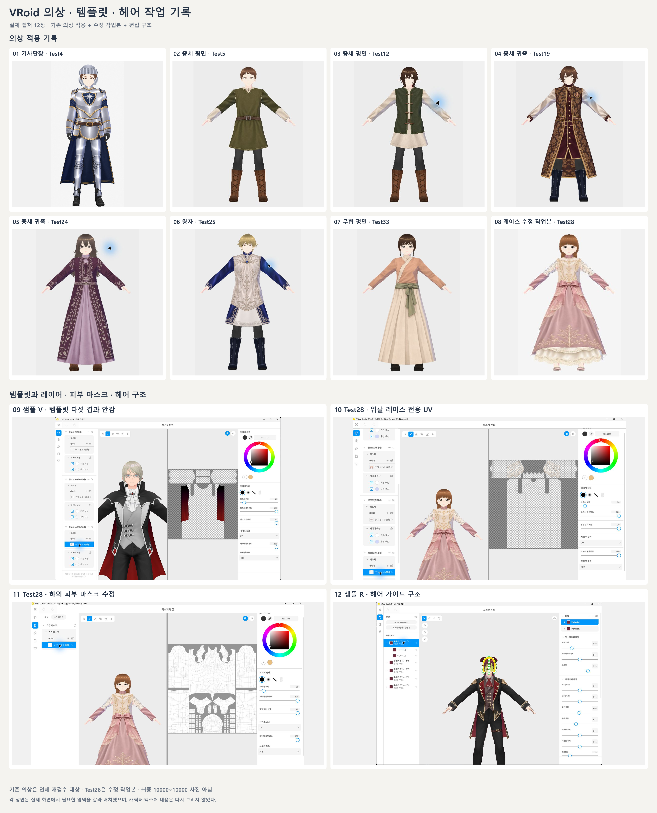

---
### 오늘 한일

**VRoid Studio 의상 제작과 템플릿 및 헤어 구조 정리**

지금까지 만든 병사·기사단장·평민·귀족·왕족·무협 의상의 적용 기록을 모으고, 참고 이미지와 실제 모델이 달라진 이유를 정리했다. 상의뿐 아니라 하의·이너·신발과 독립된 허리띠까지 함께 설계하는 방향으로 다시 잡았다.

#### 의상을 만드는 순서

1. 참고 이미지에서 몸판·소매·허리띠·겉치마·속치마·하의·신발을 나눈다.
2. 각 부위를 만들 수 있는 기본 템플릿을 고르고 해당 PNG와 UV를 확인한다.
3. 길이·폭·볼륨으로 실루엣을 먼저 맞춘다.
4. 앞뒤 몸판과 소매의 UV 위치, 캔버스 비율을 유지해 텍스처를 만든다.
5. 실제 모델에 적용하고 모든 겹의 투명 영역·피부 마스크·관절 간섭을 확인한다.

GPT로 만든 정면·후면 디자인 이미지는 참고용이다. 실제 적용용 텍스처는 선택한 템플릿의 UV에 맞춰 따로 만들어야 한다. **PNG 해상도는 무늬의 해상도이고, 옷의 넓이와 길이는 메시 설정이다.**

#### 기본 템플릿마다 다른 부분

VRoid Studio 2.14.0의 새로 만들기에서 9개 분류와 기본 변형 68개를 확인했다. 기본 레이어·마스크 PNG는 103개, 몸 관련 메시를 포함한 UV 도면은 37개로 모았다. 이미지 수와 템플릿 수는 다르다.

| 분류 | 기본 변형 수 | 확인할 차이 |
| --- | --- | --- |
| 상의 | 20 | 목선·소매·밑단, 길이·폭·볼륨 항목 |
| 원피스 | 10 | 소매 길이, 몸판과 치마 형태, UV |
| 하의 | 15 | 다리가 나뉜 바지와 이어진 치마, 주름과 허리 높이 |
| 목 액세서리 | 4 | 넥타이·리본 등의 독립 형태 |
| 팔 액세서리 | 4 | 투명형·장갑 계열과 포함된 템플릿 구성 |
| 상의 이너웨어 | 2 | 몸에 그리는 스킨과 부피가 있는 보디슈트 |
| 하의 이너웨어 | 1 | 피부에 밀착되는 속옷 구성 |
| 레그웨어 | 2 | 스킨 기반과 보디슈트 기반 구성 |
| 신발 | 10 | 펌프스·로퍼·통굽·롱부츠 등의 형태와 UV |

후드·가디건·니트처럼 같은 계열을 쓰는 변형도 기본값과 투명 영역이 다르다. 롱코트 하이넥과 셔츠 칼라·스탠드 칼라도 목둘레와 조절 항목을 따로 봐야 한다. 일부 값은 음수나 100 이상을 직접 입력할 수 있지만, 먼저 적절한 템플릿과 레이어로 형태를 맞춘다.

#### 옷 레이어와 헤어 구조

같은 템플릿의 PNG 레이어는 같은 표면의 무늬를 겹친다. **허리띠·겉치마·안감의 단차는 의상 템플릿을 따로 추가하고 각 겹의 수치를 조절해야 생긴다.** 현재 버전에서는 한 카테고리에 최대 다섯 템플릿을 겹칠 수 있다.

샘플 R에서는 겉 코트, 조끼·셔츠, 크라바트·소맷단을 나누는 최소 세 구성을 확인했다. V는 어깨 망토·칼라, 본체, 프릴·소맷단, 긴 망토, 붉은 안감의 다섯 구성이었다. V에서 관찰한 겉면 볼륨 90과 안감 88은 해당 샘플의 값이다.

헤어는 두피 커버·앞머리·옆머리·뒷머리로 나누고 가이드로 결의 방향을 만든다. 안쪽 커버 → 겉 볼륨 → 가르마·정수리 → 귀 주변·목덜미 → 잔머리 순으로 겹을 잡는다. 폭·길이·두께·비틀림·오프셋과 메인·하이라이트 텍스처를 함께 조절한다. 땋은 머리의 교차와 뿌리·끝 모양은 텍스처만으로 해결되지 않았다.

---
### 문제

참고 이미지와 실제 의상의 실루엣 차이가 컸다. 상의 중심으로 작업해 하의와 신발의 개성이 부족했고, 허리띠를 몸판에 그려 단차가 맞지 않았다. Test27·Test28의 어깨에서 내려오는 천과 레이스 아래 불투명 소매도 부자연스러웠다.

Test27은 속치마 돌출을 줄이는 일부 수정을 했지만 소매·어깨는 다시 손봐야 한다. 자작 땋은 머리도 뿌리와 뒷머리가 어색해 완성본으로 채택하지 않았다.

### 오류

Test28의 위팔 천을 투명하게 비우고 상의 피부 마스크를 고쳤는데도 팔이 보이지 않았다. 레이스 구멍 뒤에 보여야 할 피부까지 사라지는 상태였다.

### 원인

- **UV 면:** 템플릿에 면이 없는 영역에 그린 무늬는 옷 표면에 나타나지 않는다.
- **옷 PNG 알파:** 레이스가 투명해도 안쪽에 불투명 소매가 남아 있으면 피부가 보이지 않는다.
- **피부 마스크:** 검정 부분은 몸을 숨기고 흰 부분은 몸을 남긴다. Test28은 속치마로 사용한 하의의 마스크도 팔과 상체를 숨기고 있었다.
- **겹 구조:** 한 표면에 무늬를 더하는 것만으로는 허리띠·안감·레이스 사이의 간격이 생기지 않는다.

### 해결

Test28에서 위팔의 불투명 천을 제거하고 레이스를 전용 템플릿으로 분리했다. 하의의 팔·상체 숨김 범위를 복구한 뒤 양팔이 다시 보이는 것을 확인했다. 허리띠·리본과 신발 장식도 별도 구성으로 나눴다.

| 구성 | 수정 내용 |
| --- | --- |
| 상의 1 | 아이보리 몸판과 핑크 아래팔 천. 위팔은 투명하게 비움 |
| 상의 2 | 핑크 드레스 몸판과 치마 |
| 상의 3 | 금장 몸판과 꽃잎 겉치마. 어깨·소매 천 제거 |
| 상의 4 | 독립 허리띠와 리본 |
| 상의 5 | 투명 구멍이 있는 위팔 레이스 |
| 하의 3겹 | 길이가 다른 속치마와 피부 마스크 수정 |
| 신발 2구성 | 핑크 펌프스와 금장 버클·장식 |

얼굴·몸·헤어는 유지하고, 첫 상의의 전체 볼륨 13과 사용자가 조절한 어깨 접힘 주름 27.533을 보존했다. 다른 캐릭터에 그대로 넣는 공통값은 아니다. 소매 경계·레이스 늘어짐과 전체 동작의 겹침 검수는 남아 있다.

**다음 순서는 전체 의상·신발 수정 → 앞·옆·뒤와 동작 검수 → 촬영 → 헤어 재작업이다.** Test27만 고치는 것이 아니라 R03·R04·Test 전체를 참고 이미지와 비교한다. 제외한 특정 외부 웨이브 헤어는 재사용하지 않는다.

의상 검수가 끝나면 배경 불투명도 0, 10000×10000으로 대기 0·5·6·7·8·10과 정면 걷기 정지 장면을 상반신·전신으로 촬영한다. 캐릭터당 14장이며 전체 최종 사진 세트는 아직 완료 전이다.

재사용할 때는 템플릿명·PNG·수치·마스크를 함께 보관한다. 의상 아이템은 .vroidcustomitem, 편집 원본은 .vroid, 게임 적용 결과는 VRM으로 나눈다. 이번 정리에서는 Meshy를 새로 실행하지 않았고 생성·재생성 전에는 컨펌받는다.

---
