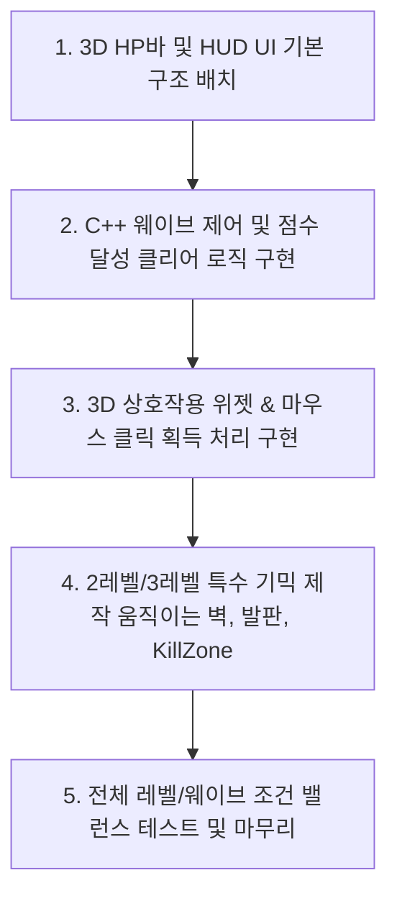

# CoinGame 분석 및 기획 구현 계획서

본 문서는 현재 **CoinGame** 프로젝트의 기존 구조를 분석하고, 요청하신 신규 기획(레벨/웨이브 시스템, 점수 조건 변경, HUD 및 메뉴 개편, 3D 상호작용 위젯, 레벨별 특수 기믹)을 구현하기 위한 C++ 소스 코드 수정 사항과 언리얼 에디터 내 작업 내용을 정리한 계획서입니다.

---

## 1. 기존 코드의 게임 구성 및 구현 방식 분석

현재 프로젝트는 다음과 같은 C++ 클래스들로 기본적인 코인 수집 게임의 뼈대를 갖추고 있습니다.

### A. 게임 흐름 및 상태 관리 (`ASpartaGameState`)
* **역할**: 게임 규칙(점수, 수집 현황, 제한 시간, 레벨 전환)을 통제하는 핵심 클래스입니다.
* **주요 흐름**:
  1. `BeginPlay()`에서 `StartLevel()` 호출.
  2. `StartLevel()`은 월드에 있는 `ASpawnVolume`을 찾아 랜덤 아이템 40개를 일시 스폰하고, 스폰된 `ACoinItem` 개수를 카운팅(`SpawnedCoinCount`).
  3. `LevelDuration`(기본 30초) 동안 타이머(`LevelTimerHandle`)가 작동하며, 시간 종료 시 `OnLevelTimeUp()` -> `EndLevel()`을 거쳐 다음 맵을 오픈하거나 게임오버 처리.
  4. 코인 획득 시 `OnCoinCollected()`가 호출되어 수집된 개수를 누적하며, **스폰된 모든 코인을 먹으면 즉시 클리어**되어 다음 레벨로 넘어감.
  5. 0.1초 주기로 `UpdateHUD()`를 돌려 플레이어 컨트롤러의 HUD 위젯에서 `Time`, `Score`, `Level` 이름의 텍스트 컴포넌트 값을 수동으로 갱신.

### B. UI 및 입력 모드 제어 (`ASpartaPlayerController`)
* **역할**: 입력 매핑과 화면에 띄우는 위젯 인스턴스(HUD, 메인 메뉴)를 제어합니다.
* **주요 흐름**:
  1. `BeginPlay()`에서 맵 이름에 `"MenuLevel"`이 포함되어 있으면 메인 메뉴 표시.
  2. `ShowMainMenu()` 호출 시 마우스 커서를 보이게 하고 입력 모드를 `UIOnly`로 설정. 재시작 여부에 따라 버튼 텍스트를 "Start" 또는 "Restart"로 바꾸고 애니메이션(`PlayGameOverAnim`) 재생.
  3. `ShowGameHUD()` 호출 시 마우스 커서를 숨기고 입력 모드를 `GameOnly`로 설정하여 HUD 위젯 화면 표시.

### C. 플레이어 캐릭터 (`ASpartaCharacter`)
* **역할**: 플레이어 조작(이동, 점프, 시선 처리, 질주) 및 체력을 관리합니다.
* **주요 흐름**:
  1. `MaxHealth`(100.0)와 `Health` 멤버 변수를 가지고 데미지를 입으면 `TakeDamage()`가 호출되어 체력을 차감.
  2. 체력이 0 이하가 되면 `OnDeath()` -> GameState의 `OnGameOver()`를 거쳐 게임 일시정지 후 메인 메뉴를 출력.
  3. 머리 위에 3D 위젯 컴포넌트(`OverheadWidget`)를 Screen Space로 부착하여 `OverHeadHP` 텍스트로 체력 수치 표시.

### D. 아이템 및 스포너 (`ABaseItem` 및 상속 액터들, `ASpawnVolume`)
* **역할**: 플레이어와 닿았을 때 상호작용하는 오브젝트들과 이를 생성하는 영역 볼륨입니다.
* **클래스 계통 구조**:
  * `IItemInterface` (Overlap 및 Activate 인터페이스)
    * `ABaseItem` (공통 충돌 감지, 스폰 사운드/이펙트 재생)
      * `ACoinItem` (획득 시 점수 추가 및 GameState 코인 카운트 호출)
        * `ABigCoinItem` (점수 50점)
        * `ASmallCoinItem` (점수 10점)
      * `AMineItem` (충돌 5초 뒤 폭발하며 범위 내 플레이어에게 데미지)
      * `AHealingItem` (충돌 시 캐릭터 체력 회복)
* **스포너**: `ASpawnVolume`은 연결된 `ItemDataTable`(데이터 테이블)에서 확률(`SpawnChance`)에 따라 아이템 종류를 결정하고, 박스 범위 내 랜덤 위치에 액터를 스폰합니다.

---

## 2. 기획에 맞춘 C++ 코드 수정 계획

기획 요구사항을 구현하기 위해 C++ 코드에서 수정/추가해야 할 구체적인 작업 항목입니다.

### 1) 레벨 & 웨이브 데이터 구조 정의
각 레벨과 웨이브별로 상이한 기획 조건(제한시간, 스폰 횟수, 디버프 여부 등)을 유연하게 처리하기 위해 GameState나 별도 구조체에 데이터를 매핑합니다.

* **[NEW] 웨이브 설정 구조체 (`FWaveConfig`) 정의**
  `SpartaGameState.h` 또는 새로운 파일에 선언합니다.
  ```cpp
  USTRUCT(BlueprintType)
  struct FWaveConfig
  {
      GENERATED_BODY()

      UPROPERTY(EditAnywhere, BlueprintReadWrite)
      int32 TargetLevel;       // 대상 레벨 (1, 2, 3)

      UPROPERTY(EditAnywhere, BlueprintReadWrite)
      int32 TargetWave;        // 대상 웨이브 (1, 2, 3)

      UPROPERTY(EditAnywhere, BlueprintReadWrite)
      int32 SpawnCount;        // 아이템 스폰 횟수

      UPROPERTY(EditAnywhere, BlueprintReadWrite)
      float LimitTime;         // 제한 시간 (초)

      UPROPERTY(EditAnywhere, BlueprintReadWrite)
      bool bSpawnDebuff;       // 디버프(지뢰) 스폰 여부

      UPROPERTY(EditAnywhere, BlueprintReadWrite)
      bool bSpawnObstacleEvent; // 충돌 이벤트 물체 활성화 여부

      UPROPERTY(EditAnywhere, BlueprintReadWrite)
      float ShuffleInterval;   // 아이템 위치 실시간 변경 주기 (0이면 안 함)
  };
  ```

### 2) 게임 스테이트 (`ASpartaGameState`) 개편
* **웨이브 기반 관리**:
  * `CurrentWaveIndex` (1~3) 변수 추가.
  * 레벨 진입 시 `StartLevel()` 대신 `StartWave()`를 호출하여 현재 레벨 및 웨이브에 해당하는 `FWaveConfig` 데이터를 적용.
* **클리어 조건 변경**:
  * 기존의 "모든 코인 수집" 조건에서 **"제한시간 내에 100 포인트 달성"**으로 수정.
  * `AddScore()` 시 현재 웨이브의 획득 점수가 100점 이상이 되면 즉시 해당 웨이브를 클리어 처리하고 다음 웨이브로 진행 (`GoToNextWave()`).
  * 3웨이브까지 모두 클리어하면 다음 레벨로 전환.
* **시간 초과 및 실패 조건**:
  * 100점을 채우지 못한 상태로 제한 시간이 만료되면 다음 웨이브가 아닌 **게임 오버 메뉴** 호출.
* **아이템 셔플 기능 (위치 실시간 변경)**:
  * `ShuffleInterval`이 지정된 웨이브에서는 타이머(`ShuffleTimerHandle`)를 구동하여 3초/5초마다 현재 맵에 존재하는 모든 아이템 액터들을 `SpawnVolume` 범위 내의 랜덤 위치로 이동 (`SetActorLocation`).

### 3) 3D 공간 상호작용 및 마우스 클릭 획득 구현
현재는 닿으면 자동으로 획득되는 방식이지만, **"3D 위젯 안내 문구가 뜨고 마우스 클릭으로 상호작용"** 하도록 변경합니다.

* **아이템 베이스 (`ABaseItem`) 수정**:
  * `UWidgetComponent* InteractionWidget` 추가. (기본적으로 비활성화/숨김 처리)
  * `OnItemOverlap`: 플레이어가 접근하면 안내 위젯("클릭하여 획득")을 표시(`SetVisibility(true)`).
  * `OnItemEndOverlap`: 플레이어가 범위를 벗어나면 안내 위젯 숨김(`SetVisibility(false)`).
  * 위젯에 포함된 클릭 영역(Button 등)을 클릭했을 때 아이템의 `ActivateItem()`이 호출되도록 바인딩.
* **플레이어 컨트롤러 (`ASpartaPlayerController`) 수정**:
  * 게임 중에도 마우스 클릭으로 위젯을 클릭할 수 있도록 마우스 커서 및 클릭 이벤트 활성화.
  * `SetInputMode(FInputModeGameAndUI())`를 설정하여 3D 위젯 클릭과 캐릭터 조작이 동시에 가능하도록 처리.
  * 마우스 커서 고정 설정(`bShowMouseCursor = true` 유지 혹은 특정 키를 누를 때만 마우스가 나타나 상호작용하도록 토글 구현).

### 4) 캐릭터 체력 HUD 연동 및 3D 체력바 (`ASpartaCharacter`)
* **3D 체력바 위젯 개편**:
  * 캐릭터 머리 위 `OverheadWidget` 컴포넌트가 참조할 위젯 클래스를 단순 텍스트가 아닌 `ProgressBar`가 포함된 위젯으로 변경.
  * `UpdateOverheadHP()` 함수에서 `UProgressBar` 컴포넌트를 얻어와 `Health / MaxHealth` 비율로 퍼센트 설정.

---

## 3. 언리얼 에디터 작업 계획

C++ 코드가 작성된 후, 언리얼 에디터 내에서 설정하고 제작해야 하는 그래픽/UI 및 레벨 리소스 작업 리스트입니다.

### 1) UI 위젯 블루프린트 (UMG) 작업
* **`WBP_HUD` (인게임 HUD)**:
  * 캔버스 패널(`CanvasPanel`)에 점수 텍스트, 시간 제한 타이머 텍스트, 그리고 **플레이어의 체력 바(ProgressBar)**를 보기 좋게 배치합니다.
  * C++ `ASpartaGameState::UpdateHUD()`에서 이 위젯의 각 컴포넌트(`Score`, `Time`, `HealthBar`)를 이름으로 찾아와 갱신할 수 있도록 변수 이름을 맞춰줍니다.
* **`WBP_MainMenu` (메인 메뉴)**:
  * 게임 타이틀, [시작] 버튼, [종료] 버튼 배치.
  * 시작 버튼 누를 시 컨트롤러의 `StartGame()`을 호출하도록 버튼 클릭 이벤트 연동.
* **`WBP_GameOver` (게임 오버 / 결과 화면)**:
  * 게임 오버 텍스트, 최종 획득 점수, [재시작] 버튼, [메인 메뉴로 돌아가기] 버튼 배치.
  * 재시작 시 `StartGame()`, 메인 메뉴 클릭 시 메뉴 레벨로 오픈하도록 바인딩.

### 2) 3D 상호작용 위젯 및 HP바 제작
* **`WBP_HPBar` (3D 머리 위 체력바)**:
  * 캐릭터의 HP를 시각적으로 보여줄 빨간색/초록색ProgressBar 위젯을 생성합니다.
* **`WBP_Interaction` (아이템 상호작용 안내)**:
  * "Click to Collect" 텍스트와 보이지 않는 클릭 영역(Button)을 배치한 위젯을 생성합니다.
  * 아이템 C++ 클래스의 `InteractionWidget` 컴포넌트에 이 위젯을 지정합니다.

### 3) 레벨별 특수 기믹 및 환경 배치
* **1레벨**: 평탄한 기본 맵 구조.
* **2레벨 (움직이는 장애물 벽 생성)**:
  * **움직이는 벽 블루프린트(`BP_MovingWall`) 제작**: StaticMesh를 가지고, Timeline 컴포넌트나 C++ Tick을 이용해 특정 두 지점 사이를 주기적으로 왕복(Lerp)하는 벽 액터입니다. 닿으면 데미지를 주도록 Overlap 시 ApplyDamage 처리.
* **3레벨 (공중 이동 발판 및 추락 실패)**:
  * **공중 이동 발판 블루프린트(`BP_FloatingPlatform`) 제작**: 2레벨의 움직이는 벽과 비슷하되, 플레이어가 딛고 이동할 수 있는 발판 형태의 액터입니다.
  * **추락 영역 처리**: 맵 하단 전체를 덮는 커다란 Box Collision Trigger인 **KillZone** 액터를 배치합니다. 플레이어가 이 영역에 닿으면 즉시 사망(`TakeDamage(MaxHealth)`)하여 게임 오버 처리가 되도록 구성합니다.

### 4) 데이터 테이블 및 에디터 구성
* **웨이브 데이터 테이블 설정**:
  * 기획에 정의된 1레벨(1~3웨이브), 2레벨(1~3웨이브), 3레벨(1~3웨이브)에 맞는 총 9개의 행(Row) 설정을 담은 데이터 테이블을 생성하고 게임스테이트에 등록합니다.
* **디버프 아이템(`AMineItem`) 설정**:
  * 데이터 테이블에서 2웨이브, 3웨이브 설정 시 디버프가 스폰될 수 있도록 확률 테이블에 지뢰 아이템의 확률을 설정하거나 스폰 가중치를 설정합니다.

---

## 4. 구현 및 검증 순서 제안

효율적인 개발을 위해 아래 순서대로 순차적으로 진행하는 것을 추천합니다.


